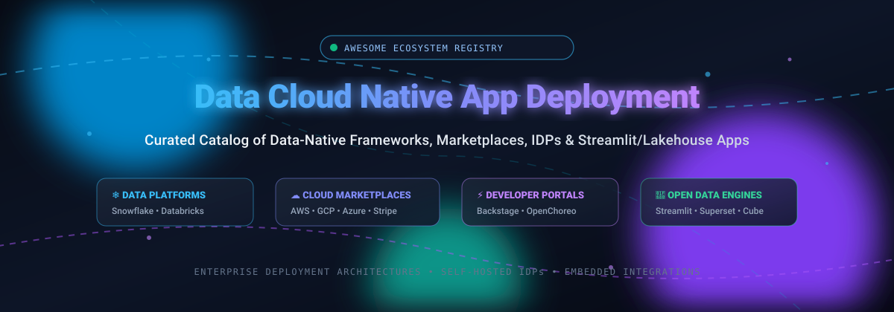

# Awesome Data Cloud Native App Deployment 🚀

  

 

**A Curated Index of Data-Native App Frameworks, Cloud Marketplaces, Developer Portals, Embedded iPaaS & Lakehouse Platforms 🌟 Star if you like it! 🌟**

*Discover, compare, and deploy applications running directly within governed data clouds, Kubernetes IDPs, and commercial software marketplaces.*

---

## 📖 Table of Contents

- [🌐 Sector Overview & Market Dynamics](#-sector-overview--market-dynamics)
- [🏢 SaaS & Hosted Commercial Platforms](#-saas--hosted-commercial-platforms)
- [💻 Open-Source GitHub Projects](#-open-source-github-projects)
  - [📊 Unified Comparison Matrix](#-unified-comparison-matrix)
  - [🔎 In-Depth Project Profiles](#-in-depth-project-profiles)
- [🤝 How to Contribute](#-how-to-contribute)
- [💖 Support & Sponsor](#-support--sponsor)
- [📈 Star History](#-star-history)
- [⚖️ Disclaimer](#-disclaimer)

---

## 🌐 Sector Overview & Market Dynamics

The **Data Cloud Native App Deployment** and **Cloud Marketplace** ecosystem represents an estimated **$30B+** addressable market, projected to surge past **$150B+ by 2030** driven by multi-year enterprise cloud commitments (EDCs) and data-native AI application frameworks. 

The infrastructure and marketplace hosting layer is **highly concentrated** among an oligopoly of hyperscalers and data cloud giants (Microsoft, AWS, Google Cloud, Salesforce, Databricks, Snowflake) benefiting from winner-take-most platform network effects and procurement lock-in. In contrast, the application tier and embedded integration layer atop them remains **moderately fragmented**, with specialized independent software vendors (ISVs), developer tooling startups, and open-source ecosystems competing for distribution and operational footprint.

---

## 🏢 SaaS & Hosted Commercial Platforms

Commercial platforms that allow developers to build, host, monetize, and distribute data applications directly within cloud data warehouses and enterprise ecosystems:

| Platform | Company Valuation / Market Cap | Pricing (Specific Starting Tiers) | Free Tier Limits (Forever Plan or Free Trial) | Key Capabilities & Ecosystem |
| :--- | :--- | :--- | :--- | :--- |
| **[Microsoft AppSource](https://appsource.microsoft.com/)** | ~$3.1T Market Cap (Microsoft) | **3%** store service fee on transactable sales; $0 listing fee for non-transacting offers | **30-day free trial** with full software feature access; requires active Microsoft/Azure billing account | Commercial marketplace storefront for Microsoft 365, Dynamics 365, and Power Platform apps. |
| **[AWS Marketplace](https://aws.amazon.com/marketplace)** | ~$2.2T Market Cap (Amazon) | **3.0%** listing fee on SaaS and AWS Data Exchange (<$1M TCV); scales to **2.0%** ($1M–$10M) and **1.5%** (≥$10M); 20% on AMIs/containers | **Free trial configured per seller** (typically 15 to 30 days) covering software fees; AWS infrastructure usage billed separately; $0 marketplace listing creation fee | Central enterprise marketplace offering streamlined procurement, private offers, and automated billing through AWS accounts. |
| **[Google Cloud Marketplace](https://cloud.google.com/marketplace)** | ~$2.1T Market Cap (Alphabet) | **3.0%** publisher revenue share for standard public and private offers under $1M; **2.0%** ($1M–$10M); **1.5%** (≥$10M) | **Free trial with seller-specified credit/days limit** (e.g., 30 days or $100–$500 software credit); underlying GCP compute/storage billed separately; Google Cloud offers 90-day/$300 trial for new GCP accounts (requires upgrade to paid billing for marketplace access) | Cloud software distribution and procurement platform integrated into Google Cloud customer billing. |
| **[Salesforce AppExchange](https://appexchange.salesforce.com/)** | ~$320B Market Cap (Salesforce) | **15%** standard Percentage Net Revenue (PNR) share for paid apps; **$999** security review fee per submission attempt | **Perpetually free tier for free apps** ($0 security review fee, $0 revenue share); 30-day free trials typically offered for paid apps | Leading enterprise SaaS marketplace distributing connected apps and extensions with strict compliance and security reviews. |
| **[Databricks Apps](https://www.databricks.com/)** | ~$134B Valuation (Late 2025 Series K/L) | **$0.07 to $0.55 per DBU** depending on compute tier and workload (Jobs vs. All-Purpose/Serverless Compute) | **14-day free trial** with up to $400 in Databricks usage credits; perpetually free **Community Edition** with single-micro-cluster allocation for non-commercial learning | Serverless application hosting inside Databricks Lakehouse with automatic Unity Catalog governance inheritance and AppKit SDK support. |
| **[Shopify App Platform](https://shopify.dev/docs/apps/build)** | ~$115B Market Cap (Shopify) | **0%** revenue share on first **$1,000,000** lifetime gross revenue; **15%** revenue share above $1M threshold; **$19** one-time developer registration fee; 2.9% payment processing fee | **Perpetually free tier**: 0% rev share on first $1M gross app revenue for eligible partners; unlimited sandbox and development stores under Shopify Partner accounts | App store distribution reaching millions of Shopify merchants with Polaris UI components and checkout extensions. |
| **[Stripe Apps](https://docs.stripe.com/stripe-apps)** | ~$91.5B Valuation (2025 Tender Offer) | **0%** marketplace revenue share; standard Stripe payment processing fee of **2.9% + $0.30** per transaction applies to billed payments | **Perpetually free tier**: $0 developer registration fee, free sandbox testing environment, and $0 platform fee for free marketplace apps | Extensions and custom UI integrations embedded directly inside the Stripe Merchant Dashboard. |
| **[Snowflake Native App Framework](https://docs.snowflake.com/en/developer-guide/native-apps/native-apps-about)** | ~$60B Market Cap (Snowflake) | **$2.00/credit** (Standard Edition), **$3.00/credit** (Enterprise Edition), **$4.00/credit** (Business Critical Edition); compute billed per second (60s minimum) | **30-day free trial** with **$400** in platform credits (expires after 30 days or credit exhaustion) | Build, distribute, and monetize containerized and data applications running natively inside the consumer's Snowflake warehouse. |
| **[Workato Embedded](https://docs.workato.com/en/oem/partner-program)** | ~$5.7B Valuation (Series E) | Base workspace starting at **$10,000/year**; mid-market deployments typically **$30,000–$80,000/year** | **Perpetually free self-service tier with a one-time grant of 50,000 credits** (does not renew monthly; expires once 50,000 credits are consumed across tasks/APIs) | Embedded integration platform (iPaaS) allowing SaaS software vendors to deliver white-labeled customer-facing integrations. |
| **[Heroku Elements](https://elements.heroku.com/)** | Sub-unit of Salesforce (~$320B Parent Market Cap) | **30%** Heroku marketplace revenue share (70% net revenue paid to add-on partner); base developer dynos start at **$5/month** (Eco dynos pool) | **Perpetually free add-on plan tier** available for partner listings; dyno environment offers $5/mo shared pool of 1,000 Eco dyno hours that sleep after 30m inactivity | Add-on and integrations marketplace for Heroku PaaS developers and applications. |

---

## 💻 Open-Source GitHub Projects

Explore the top self-hosted open-source technologies spanning internal developer platforms (IDPs), data app frameworks, orchestrators, semantic layers, and catalogs.

### 📊 Unified Comparison Matrix

The repositories below are **strictly sorted descending by GitHub star count**. Each badge is rendered with `style=social` and `color=white`, directly linking to the stargazers page of that repository:

| Rank | Repository | Stars (Social Badge) | Primary Category | Tech Stack | License |
| :---: | :--- | :---: | :--- | :--- | :--- |
| **01** | **[Apache Superset](https://github.com/apache/superset)** |  | Data Exploration & Embedded Apps | Python, TypeScript, React | Apache-2.0 |
| **02** | **[Metabase](https://github.com/metabase/metabase)** |  | Self-Service & Embedded Analytics | Clojure, TypeScript, React | AGPL-3.0 |
| **03** | **[Streamlit](https://github.com/streamlit/streamlit)** |  | Python Data App Framework | Python, TypeScript, React | Apache-2.0 |
| **04** | **[Gradio](https://github.com/gradio-app/gradio)** |  | Interactive ML & Data Apps | Python, TypeScript, Svelte | Apache-2.0 |
| **05** | **[Backstage](https://github.com/backstage/backstage)** |  | Internal Developer Portal (IDP) | TypeScript, Node.js, React | Apache-2.0 |
| **06** | **[Plotly Dash](https://github.com/plotly/dash)** |  | Enterprise Data Apps & Dashboards | Python, JavaScript, React | MIT |
| **07** | **[Temporal](https://github.com/temporalio/temporal)** |  | Resilient Workflow Orchestration | Go | MIT |
| **08** | **[Prefect](https://github.com/prefecthq/prefect)** |  | Data Pipeline & Workflow Engine | Python | Apache-2.0 |
| **09** | **[Marimo](https://github.com/marimo-team/marimo)** |  | Reactive Notebooks & Data Apps | Python, TypeScript | Apache-2.0 |
| **10** | **[Cube](https://github.com/cube-js/cube)** |  | Universal Semantic Layer & API | Rust, TypeScript | Apache-2.0 |
| **11** | **[Taipy](https://github.com/Avaiga/taipy)** |  | Full-Stack Data & AI Applications | Python, React | Apache-2.0 |
| **12** | **[Dagster](https://github.com/dagster-io/dagster)** |  | Asset-Based Orchestrator | Python, React | Apache-2.0 |
| **13** | **[Evidence](https://github.com/evidence-dev/evidence)** |  | Code-Driven BI & Markdown Apps | Svelte, TypeScript, SQL | MIT |
| **14** | **[Panel](https://github.com/holoviz/panel)** |  | High-Performance Data Exploration | Python, Bokeh, JavaScript | BSD-3-Clause |
| **15** | **[Apache Gravitino](https://github.com/apache/gravitino)** |  | Federated Metadata Lakehouse Catalog | Java, Python | Apache-2.0 |
| **16** | **[OpenChoreo](https://github.com/openchoreo/openchoreo)** |  | Kubernetes Internal Developer Platform | Go, Kubernetes | Apache-2.0 |
| **17** | **[Flowfile](https://github.com/Edwardvaneechoud/Flowfile)** |  | Visual Data Pipelines & Delta Lake | Python, Polars, Delta Lake | Apache-2.0 |

---

### 🔎 In-Depth Project Profiles

#### 1. [Apache Superset](https://github.com/apache/superset) 
- **Overview**: Leading enterprise open-source data exploration and visualization platform capable of handling petabyte-scale data.
- **Key Capabilities**: Rich dashboard and chart builder, SQL Lab query editor, semantic metrics layer, granular security models, and embedded SDK for embedding charts into web apps.
- **Role in Stack**: Powers interactive user interfaces and embedded analytical dashboards directly on top of modern cloud warehouses.

#### 2. [Metabase](https://github.com/metabase/metabase) 
- **Overview**: Intuitive open-source business intelligence server designed for rapid self-service analytics and customer-facing embedded apps.
- **Key Capabilities**: Visual question builder, interactive drill-downs, automatic dashboard generation, and signed embedding for multi-tenant customer applications.
- **Role in Stack**: Turnkey reporting and customer-facing data app deployment for SaaS products.

#### 3. [Streamlit](https://github.com/streamlit/streamlit) 
- **Overview**: The premier Python framework that turns data scripts into shareable web apps in minutes without frontend engineering.
- **Key Capabilities**: Pure Python state management, reactive execution model, vast ecosystem of widgets, and native runtime in Snowflake (Snowpark) and Databricks Apps.
- **Role in Stack**: Standard UI development framework for native apps on Snowflake and Databricks.

#### 4. [Gradio](https://github.com/gradio-app/gradio) 
- **Overview**: Rapid prototyping framework for machine learning models, generative AI interfaces, and interactive data apps.
- **Key Capabilities**: Generates intuitive web UIs with zero HTML/CSS/JS, supports streaming outputs and multi-modal components (images, audio, chat), and easily embeds anywhere.
- **Role in Stack**: Premier front-end for AI/ML and generative data applications running on Databricks Lakehouse Apps.

#### 5. [Backstage](https://github.com/backstage/backstage) 
- **Overview**: CNCF Incubation internal developer portal platform created by Spotify to organize microservices, data apps, and documentation.
- **Key Capabilities**: Software Catalog, Software Templates (scaffolding new services), TechDocs (docs-as-code), and hundreds of modular ecosystem plugins.
- **Role in Stack**: Developer portal and internal software marketplace for standardizing data app scaffolding, ownership, and discovery.

#### 6. [Plotly Dash](https://github.com/plotly/dash) 
- **Overview**: Low-code framework for building enterprise-grade data applications with complex reactive analytics and charts.
- **Key Capabilities**: Direct integration with Plotly visualization engine, Flask backend, React UI wrappers, and full styling customization.
- **Role in Stack**: Powers analytical dashboards and data applications deployed natively on Databricks Apps or self-hosted Kubernetes clusters.

#### 7. [Temporal](https://github.com/temporalio/temporal) 
- **Overview**: Durable workflow execution engine ensuring code execution completes reliably even across process failure or network partitions.
- **Key Capabilities**: Code-as-workflows (Go, Python, TypeScript, Java), automatic state persistence, retry policies, timers, and distributed transactions.
- **Role in Stack**: Provides the mission-critical reliable backend execution layer for multi-step cloud data app workflows and long-running provisioning tasks.

#### 8. [Prefect](https://github.com/prefecthq/prefect) 
- **Overview**: Python-native workflow orchestration system built for modern distributed data applications and pipelines.
- **Key Capabilities**: Dynamic task generation, async Python support, observable execution states, distributed worker infrastructure, and native cloud deployment triggers.
- **Role in Stack**: Orchestrates the automated data pipelines and ETL processes feeding native data applications.

#### 9. [Marimo](https://github.com/marimo-team/marimo) 
- **Overview**: Next-generation reactive Python notebook that doubles as a reproducible data application builder and script runner.
- **Key Capabilities**: Directed acyclic graph (DAG) reactive execution, zero hidden state, pure Python file serialization (`.py`), and seamless export to standalone interactive web apps.
- **Role in Stack**: Modern reactive notebook environment for exploratory analysis that compiles instantly into deployable data apps.

#### 10. [Cube](https://github.com/cube-js/cube) 
- **Overview**: Universal semantic layer designed to connect data stores to any application or business intelligence tool.
- **Key Capabilities**: Centralized data modeling, SQL/REST/GraphQL APIs, high-performance pre-aggregations cache, and multi-tenant security controls.
- **Role in Stack**: Decouples data application logic from underlying data warehouses (Snowflake, Databricks, BigQuery) for consistent metrics computation.

#### 11. [Taipy](https://github.com/Avaiga/taipy) 
- **Overview**: Full-stack Python framework specifically engineered for building production-ready data and AI applications.
- **Key Capabilities**: Pre-built graphical UI components, integrated pipeline orchestrator, scenario and what-if analysis engine, and high-concurrency architecture.
- **Role in Stack**: Builds end-to-end operational data applications with integrated backend pipelines without juggling separate orchestration tools.

#### 12. [Dagster](https://github.com/dagster-io/dagster) 
- **Overview**: Cloud-native data orchestrator focused on software-defined assets and development lifecycle.
- **Key Capabilities**: Asset-oriented data cataloging, rich local development and unit testing harness, lineage tracking, and declarative scheduling.
- **Role in Stack**: Manages data dependencies and ensures governed upstream data feeds for lakehouse native apps.

#### 13. [Evidence](https://github.com/evidence-dev/evidence) 
- **Overview**: Open-source framework for building high-performance data applications and reports using Markdown and SQL.
- **Key Capabilities**: DuckDB-powered in-memory querying, fast Svelte rendering, git-based version control, and static site deployment to any cloud CDN.
- **Role in Stack**: Delivers instant, lightning-fast static and interactive analytical reports without traditional heavy BI server infrastructure.

#### 14. [Panel](https://github.com/holoviz/panel) 
- **Overview**: Powerful Python library for creating complex interactive dashboards and apps from Jupyter notebooks or standalone scripts.
- **Key Capabilities**: Deep integration with PyData ecosystem (Bokeh, Matplotlib, Plotly, Altair), support for massive streaming datasets, and WebAssembly (Pyodide) browser execution.
- **Role in Stack**: Enterprise scientific data app and complex dashboard deployment.

#### 15. [Apache Gravitino](https://github.com/apache/gravitino) 
- **Overview**: High-performance, geo-distributed federated metadata lakehouse catalog (Apache TLP).
- **Key Capabilities**: Unified metadata governance across data warehouses, lakes, streaming brokers, and AI models; MCP server for AI agent integrations; fine-grained access control.
- **Role in Stack**: Multi-cloud metadata backbone connecting data sources to native apps across distributed clouds.

#### 16. [OpenChoreo](https://github.com/openchoreo/openchoreo) 
- **Overview**: CNCF Sandbox open-source internal developer platform (IDP) purpose-built for deploying applications on Kubernetes.
- **Key Capabilities**: Multi-plane architecture (control, runtime, observability), built-in GitOps (FluxCD), CI/CD, Backstage portal integration, self-service databases/queues, and MCP servers for AI agents.
- **Role in Stack**: Production-grade platform for self-hosting containerized microservices and data applications on Kubernetes.

#### 17. [Flowfile](https://github.com/Edwardvaneechoud/Flowfile) 
- **Overview**: Visual data pipeline builder with sandboxed Python execution and native Delta Lake integration.
- **Key Capabilities**: 30+ visual pipeline transformation nodes, Delta Lake versioned storage, Polars acceleration, and standalone script export.
- **Role in Stack**: Lightweight self-hosted ETL and data transformation engine for powering local and cloud data applications.

---

## 🤝 How to Contribute

Contributions are welcome and appreciated! Follow these steps to submit additions or improvements:

1. 🍴 **Fork** this repository.
2. 🌿 Create a feature branch: `git checkout -b feature/new-platform-or-tool`.
3. ✏️ Add or update entries following the table format (include accurate starting prices, free tier details, star badges, and links).
4. 🧪 Verify that markdown links and image tags render correctly.
5. 🚀 Submit a **Pull Request** with a concise summary of the changes.

---

## 💖 Support & Sponsor

Thank you for exploring and supporting **Awesome Data Cloud Native App Deployment**! If you find this curated resource helpful for your architecture, team, or projects:

- ⭐ **Star this repository** to help others discover it!
- 🍴 **Fork and share** with colleagues and developer communities.
- 💬 **Join our community** on [Discord](https://discord.gg/jc4xtF58Ve) to discuss data app deployment patterns.
- ☕ **Buy a coffee & sponsor**: If you'd like to support ongoing curation and open-source maintenance, please consider sponsoring through the [GitHub Sponsor Dashboard](https://github.com/sponsors/ishandutta2007). Your support is greatly appreciated!

---

## 📈 Star History

---

## ⚖️ Disclaimer

- This is a **community-curated** list — not exhaustive and not an official vendor endorsement.
- Data app deployment platforms handling application logic and data access must comply with corporate data governance standards and regional regulations (GDPR, CCPA, HIPAA, etc.).
- **Data-Platform-Native Framework vs. Developer Portal vs. Kubernetes IDP**:
  - **Snowflake Native Apps & Databricks Apps**: Run applications natively inside the cloud data warehouse with inherited user governance, compute, and catalog security.
  - **Backstage**: Focuses on the developer portal, discovery, and service catalog layers without hosting or running application workloads directly.
  - **OpenChoreo**: Kubernetes-native internal developer platform designed for deploying containerized services and APIs.
  - **Cube / Superset / Streamlit**: Application, visualization, and semantic layer technologies running on top of underlying cloud data stores.
- Pricing metrics, cloud compute rates, and free tier parameters are based on official vendor documentation as of late 2025/2026 and are subject to change by respective platform providers.

---

  <b>Built with ❤️ for platform engineers, analytics engineers, and data cloud app developers.</b>

